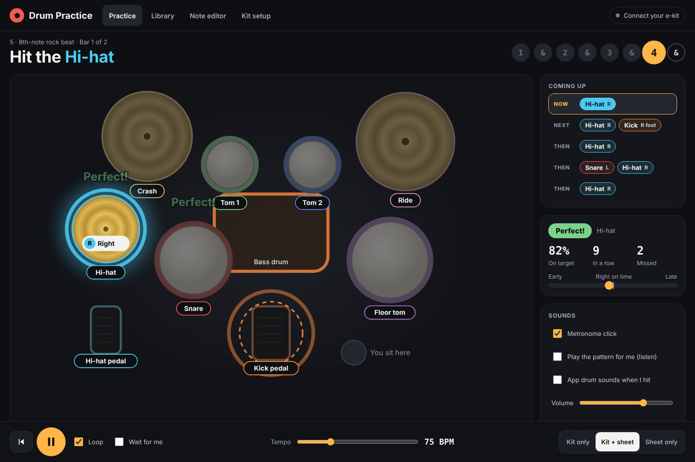
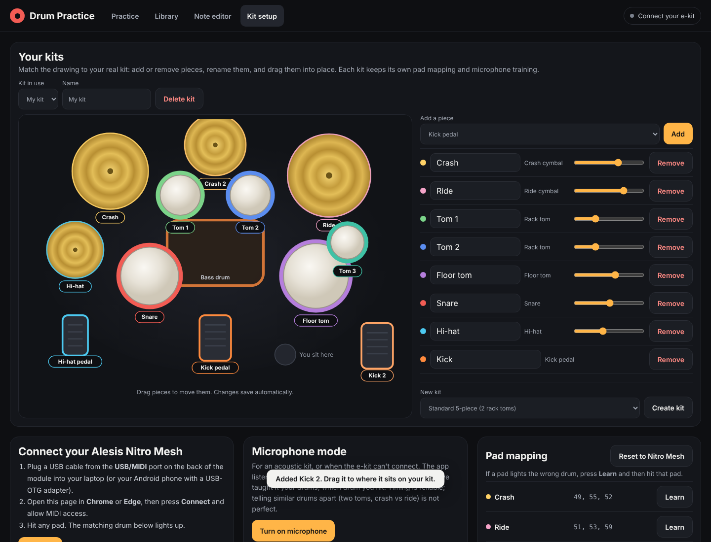

# Drum Practice

**Live app: <https://sanskarlather.github.io/drum-practice/>**

A browser app for learning drums. A drawing of your kit lights up the drum to hit next, a ring closes in to show *when* to hit it, and a tag tells you which hand or foot to use. It listens to your playing and tells you whether each hit was on time and on the right drum.

It works with:

- **An electronic kit over USB** (built and tested around the Alesis Nitro Mesh, but any kit that sends standard MIDI notes works), or
- **A microphone**, for acoustic kits or when the e-kit can't be connected, or
- **Taps and keyboard keys**, so you can try it with no kit at all.

It runs entirely in the browser: there is no server or account, and nothing you play leaves your device.



> **Built with AI, tested by a human.** Most of the code and documentation in this repository was written by an AI assistant (Claude, by Anthropic) working from my requirements, mockups and feedback. I'm responsible for testing it on real drums and deciding what's good enough. See [How this was made](#how-this-was-made) and [docs/TESTING.md](docs/TESTING.md) for what has and hasn't been checked.

---

## Contents

- [Features](#features)
- [Quick start](#quick-start)
- [Using it with an e-kit (Alesis Nitro Mesh)](#using-it-with-an-e-kit-alesis-nitro-mesh)
- [Using it with a microphone](#using-it-with-a-microphone)
- [Reading sheet music (PDF or photo)](#reading-sheet-music-pdf-or-photo)
- [Customising your kit](#customising-your-kit)
- [Adding your own music](#adding-your-own-music)
- [Browser and device support](#browser-and-device-support)
- [Known limitations](#known-limitations)
- [Project structure](#project-structure)
- [How this was made](#how-this-was-made)
- [Testing status](#testing-status)
- [Documentation](#documentation)
- [License](#license)

## Features

**Practice**
- A top-down kit drawing, seen from the drummer's seat, with every piece labelled.
- The drum(s) to hit glow; a shrinking ring shows the exact moment; "NEXT" marks the drum after that.
- Hand and foot tags (Right / Left hand, R foot / L foot) worked out from the pattern.
- A plain-language instruction ("Hit Snare + Hi-hat together"), a big 1 & 2 & 3 & 4 & counter and a "Coming up" list.
- Feedback on every hit: Perfect, Good (early/late), Too early, Too late, Miss, Wrong drum?
- Accuracy, streak, misses and an early/late timing meter.
- **Articulations are taught and checked**, not simplified: open vs closed hi-hat, accents, ghost notes, rimshots, cross-stick, flams, ride bell and cymbal chokes. The kit shows "OPEN", "ACCENT", "GHOST"… on the drum, the notation draws them properly, and your playing is checked: the open-hi-hat and rim notes your kit sends, and how hard you hit for accents and ghost notes.
- **Wait for me** mode: the song pauses until you hit the right drum.
- Loop, tempo slider (30-200 BPM), 4-click count-in.
- Optional simplified drum notation that scrolls with the music.

**Sound**
- Metronome click (accented on beat 1).
- "Play the pattern for me", so you can hear it before you play it.
- Built-in drum sounds for when your module is muted (or for tap mode).

**Music**
- 15 built-in lessons, from "hi-hat only" to fills around the toms, accents, open hi-hats, ghost notes, cross-stick with ride bell, flams and rimshots.
- Import **MIDI** (`.mid`) and **MusicXML** (`.musicxml`, `.xml`) files.
- **Read a PDF or photo of drum sheet music automatically**, with the AI reader (your own key from Google Gemini, Groq, OpenRouter, Anthropic Claude or any OpenAI-compatible service; Gemini, Groq and OpenRouter have free options, and a local Ollama/LM Studio model is free and private) or the free offline reader.
- A **note editor**: click a grid, or **record from your kit** after a count-in.
- Your songs and best scores are saved in your browser.

**Kits**
- Keep several kits (for example "Nitro Mesh at home" and "Acoustic kit at class") and switch between them.
- Add more of any piece (extra toms, floor toms, crashes, splash, china, a second kick for a double pedal), remove what you don't have, rename pieces, resize them and drag them into place.
- Each kit has its own pad mapping and microphone training. Songs written for other kits play on the closest pieces you have.

**Works on your phone**
- Responsive layout for phones and tablets.
- Can be installed to the home screen and opened offline when hosted on GitHub Pages.

## Quick start

**Option 1: use the hosted version** (recommended). Open **<https://sanskarlather.github.io/drum-practice/>** in Chrome or Edge. To host your own copy, see [docs/HOSTING.md](docs/HOSTING.md).

**Option 2: open it from your computer.** Download this repository, then double-click `index.html` and open it in Chrome or Edge. Everything works this way, though the hosted version is better for phones.

Then:
1. Go to **Library** and pick **1 · Meet the hi-hat**.
2. Press the big play button (or Enter). You'll hear four count-in clicks.
   (Hold **Shift** with a key for the special stroke: Shift+A = open hi-hat, Shift+S = rimshot, Shift+H = ride bell.)
3. Hit the glowing drum when the ring reaches it.

No kit handy? Tap the drums on screen, or use the keys: `A` hi-hat, `S` snare, `Space` kick, `D`/`F` toms, `G` floor tom, `Q` crash, `H` ride, `Z` hi-hat pedal.

## Using it with an e-kit (Alesis Nitro Mesh)

1. Connect a USB cable from the **USB/MIDI** port on the back of the drum module to your laptop. On an Android phone, use a USB-OTG adapter.
2. Open the app in **Chrome** or **Edge**, go to **Kit setup** and press **Connect**. Allow MIDI access when the browser asks.
3. Hit each pad: the matching drum lights up. The app ships with the Nitro Mesh's default note numbers (kick 36, snare 38/40, toms 48/45/43, hi-hat 42/46/44, crash 49, ride 51) plus standard General MIDI fallbacks.
4. If a pad lights the wrong drum, press **Learn** next to the right drum and hit that pad.
5. If every hit reads "late" even when it sounds right, adjust **Hit timing adjustment** in Kit setup.

Keep listening through the module's headphone output as usual; the app only adds the click (and anything else you switch on under **Sounds**).

## Using it with a microphone

Microphone mode is for acoustic kits, or for when the e-kit won't connect.

1. Open **Kit setup** and press **Turn on microphone**. Allow microphone access.
2. Hit a drum: the level bar should jump past the white line. Adjust **Sensitivity** if needed.
3. **Teach it your drums:** press **Teach** next to each drum you have and hit it 6 times. This is how the app learns what *your* drums sound like in *your* room.
4. Choose how strict drum checking should be: forgiving (any tom counts for a tom; crash and ride are interchangeable), strict, or timing only.
5. Press **Measure delay** with your speakers up. The app plays 8 clicks and times how long the mic takes to hear them.
6. Practise **with headphones** for the metronome, otherwise the mic will hear the clicks as hits.

What to expect: timing detection is reliable. Telling kick, snare and hi-hat apart works well. Similar drums (two toms, crash vs ride) and three or more drums at once are less reliable, which is why the forgiving mode exists. Details are in [docs/ARCHITECTURE.md](docs/ARCHITECTURE.md#microphone-mode).

## Reading sheet music (PDF or photo)

In **Library**, choose **PDF or photo** (or drop the file on the page). The app shows the pages, you pick a reader, and the notes it finds open in the note editor next to the sheet so you can check them.

| | AI reader | Offline reader |
|---|---|---|
| How it works | Sends the page images to an AI model from the provider you choose | Optical music recognition, in your browser |
| Accuracy | Best; handles photos, repeats, most notation (depends on the model) | Good on clean printed sheets with simple rhythms |
| Cost | Free within Gemini's free tier, Groq's free plan or OpenRouter's free models; otherwise charged to **your own** account | Free |
| Privacy | Pages are sent to that provider | Nothing leaves your device |
| Needs | An API key and internet | Nothing |

**AI providers** (choose under **Library → Sheet reading → AI provider**):

| Provider | Cost | Get a key |
|---|---|---|
| **Google Gemini** (default) | Free tier, no payment needed; limited requests per day. On the free tier Google may use what you send to improve its products. | [aistudio.google.com/apikey](https://aistudio.google.com/apikey) |
| **Groq** | Free plan with rate limits; very fast. Vision models: Llama 4 Scout (default), Qwen 3.8 27B | [console.groq.com/keys](https://console.groq.com/keys) |
| **OpenRouter** | Free models (ending in `:free`, or the `openrouter/free` router, which picks a random one) with daily limits; paid models too | [openrouter.ai/settings/keys](https://openrouter.ai/settings/keys) |
| **Anthropic Claude** | Needs prepaid API credit | [console.anthropic.com](https://console.anthropic.com/settings/keys) |
| **Other OpenAI-compatible** | Depends on the service. A local **Ollama** or **LM Studio** server with a vision model is free and private (runs on your computer) | From that service; enter its base URL too |

**Your own API key.** The AI reader never uses a key built into the app: there isn't one. Each person who wants it pastes their own key. It's stored only in that browser (or for the current session only, if you untick *Remember*), sent only to the provider you chose, and never part of this repository. So nobody using your copy of the app can run up charges on your account. **Test key** and **Load models** only list the models your key can use, which costs nothing. Without a key, the app uses the offline reader.

**How the AI is asked:** each page is sent on its own, and the AI answers in compact drum-tab lines (`HH x.x.x.x.x.x.x.x.`), one per drum per bar. That keeps answers short, so they fit within free models' output limits; "thinking" is kept low where the provider allows. If one provider is busy or at its free limit, the app waits and retries once; you can also switch provider and press **Read again**.

The offline reader marks what it found on the page (circles around notes, blue barlines, bar numbers), so you can spot mistakes quickly. Either way, always check the result before practising.

## Articulations (how each note is played)

Playing the right drum at the right time is only half of drumming; *how* you hit it matters too. The app keeps these apart everywhere: lessons, imports, the sheet readers, the editor, the practice display and the judging.

| Articulation | On the kit display | In the notation | How it's checked |
|---|---|---|---|
| Open hi-hat | OPEN | `o` above the hi-hat | Your kit sends a different note (Nitro Mesh: 46 open, 42 closed). Closed where open is written, or open where closed is written, is marked wrong |
| Accent | ACCENT | `>` | Velocity at or above the *Accent* level (default 96) |
| Ghost note | GHOST | note in `( )` | Velocity at or below the *Ghost note* level (default 55) |
| Rimshot | RIM | slashed notehead | The pad's rim note (Nitro Mesh snare rim: 40) |
| Cross-stick | X-STICK | circled x on the snare line | The cross-stick note (General MIDI 37), if your kit sends one |
| Ride bell | BELL | diamond notehead | The bell note (53), if your ride pad has a bell zone |
| Flam | FLAM | small grace note | Shown and played; not checked (it's two hits a few ms apart) |
| Choke | CHOKE | `+` | Shown and played; not checked |

- When a hit is on time but played the wrong way, it's graded **"Right time, wrong touch"** with a tip (e.g. "Lift your left foot so the hi-hat rings") and breaks your streak. **Wait for me** waits until it's played right.
- Turn checking off with **Check how I play each note** in the Sounds panel, while you're learning the notes.
- Set the accent and ghost-note levels in **Kit setup → Accents and ghost notes**. *Last note received* shows the velocity of each hit, so you can find your levels.
- Pad mapping has extra rows for the special strokes (Hi-hat: open, Snare: rimshot, Snare: cross-stick, Ride: bell), each with **Learn**.
- In microphone mode you can also teach the open hi-hat, rimshot, cross-stick and ride bell; accents and ghost notes are judged by loudness compared with your normal hits.
- MIDI files keep open hi-hat (46), cross-stick (37) and ride bell (53), and accents and ghost notes from velocity. MusicXML keeps accents, ghost notes (parenthesised noteheads), open hi-hat and flams (grace notes). The AI reader writes them in its drum tab. The **offline reader doesn't detect articulations**; add them in the editor.

## Customising your kit

In **Kit setup → Your kits**:



1. **Add a piece:** pick a type (crash, ride, splash, china, hi-hat, snare, rack tom, floor tom, kick pedal, hi-hat pedal) and press **Add**. It's placed in a free spot; drag it to where it sits on your real kit.
2. **Rename, resize or remove** pieces in the list.
3. **Create kit** makes a new one from a preset (standard 5-piece, small 4-piece, big kit) or a copy of the current kit. Switch kits with **Kit in use**.
4. New pieces get sensible MIDI notes where there's a standard one (for example crash 2 gets note 57). For pads that send something else, use **Learn** under **Pad mapping**.

Each kit remembers its own layout, pad mapping and microphone training. If a song uses a piece your kit doesn't have (for example Tom 3 on a kit with two toms), it's played on the closest piece you do have. A second kick pedal is treated as the left foot of a double pedal.

## Adding your own music

| Source | How it's handled |
|---|---|
| MIDI file | Drum notes (channel 10) become notes on the grid, with tempo and time signature. |
| MusicXML | Read from instrument names, or from note positions in standard drum notation. Export *uncompressed* (`.musicxml`), not `.mxl`. |
| PDF / photo | Read automatically by the AI or offline reader (see above), then opened in the editor with the sheet shown above the grid. |
| Note editor | Click squares (16th notes) or press **Record from kit**. |

Every import opens in the note editor first so you can check it. The [`samples/`](samples) folder has a MIDI and a MusicXML file to try.

## Browser and device support

| | Practice & editor | E-kit over USB | Microphone | Install to home screen |
|---|---|---|---|---|
| Chrome / Edge on Windows, Mac, Linux | Yes | Yes | Yes | Yes |
| Chrome on Android | Yes | Yes (USB-OTG adapter) | Yes | Yes |
| Firefox (desktop) | Yes | Yes (asks for permission) | Yes | No |
| Safari on Mac / iPhone / iPad | Yes | **No** (Safari has no Web MIDI) | Yes | iPhone: "Add to Home Screen" |

The offline sheet reader works everywhere; the AI reader needs an internet connection.

## Known limitations

- The **offline sheet reader** works best on clean, printed, straight sheets with simple rhythms. It assumes notes are spaced roughly in proportion to time, so mixed rhythms, triplets, repeat signs, multi-bar rests and handwritten music often come out wrong. It reads up to 8 pages.
- The **AI reader** is much better but can still make mistakes (free and smaller models make more), needs internet and your own API key, and is subject to each provider's limits.
- The note grid is 16th notes only. Triplets, swing and grace notes are rounded to the nearest 16th.
- 4/4 and 3/4 only in the editor.
- Compressed MusicXML (`.mxl`) isn't supported.
- Flams and chokes are shown and played but not checked. Microphone mode only tells open and closed hi-hat (and rimshot, bell) apart if you've taught both, and only roughly.
- Microphone drum identification can confuse similar-sounding drums (see above).
- Songs are stored in this browser only. Clearing site data deletes them, and they don't sync between your laptop and phone.

## Project structure

```
index.html            Page layout for all four screens
css/styles.css        All styling
js/                   Plain scripts, loaded in this order:
  data.js             Piece types, default MIDI notes, fallbacks between pieces
  artic.js            Articulations: open hi-hat, accent, ghost, rimshot, cross-stick, bell, flam, choke
  storage.js          Saved settings, songs and best scores (localStorage)
  lessons.js          The 10 built-in lessons
  util.js             Small DOM helpers
  kits.js             Kits: presets, adding/removing/moving pieces, switching
  audio.js            Synthesised drum sounds and metronome
  song.js             Turns a song into timed events with hand assignments
  kit.js              Draws the kit and animates lights, rings and hand tags
  engine.js           Playback clock, count-in, loop, wait mode, hit judging
  sheet.js            Simplified drum notation strip
  midi.js             USB/MIDI input and pad mapping
  mic.js              Microphone hit detection, drum teaching, mic judging
  importers.js        MIDI and MusicXML file readers
  library.js          Library screen and imports
  sheetreader.js      PDF/photo reading: AI reader and offline reader
  editor.js           Note editor, record from kit, sheet tracing
  app.js              Navigation, controls and start-up
manifest.webmanifest  App name and icons for "Add to Home screen"
sw.js                 Offline support (network first)
icons/                App icons
vendor/pdfjs/         PDF.js (Mozilla, Apache 2.0) for reading PDF pages
samples/              Example MIDI and MusicXML files
tests/                Automated browser tests (Python + Playwright)
docs/                 User guide, hosting guide, architecture, testing
```

There's no build step and nothing to install: edit a file, refresh the page. The only third-party code is PDF.js, included in `vendor/`.

## How this was made

This project was built in conversation with an AI assistant (Claude, by Anthropic):

- **Me (the human):** the idea and requirements (an e-kit practice app with a visual kit for absolute beginners, phone support, microphone mode, automatic sheet reading with each user's own API key from any provider, customisable kits), feedback on the mockups (I asked for the drum kit to be the main element instead of falling notes), choices about devices and features, and testing on real hardware.
- **The AI:** the mockups, all of the code, the lessons, the automated tests and the first draft of these documents.

Automated tests (run by the AI in a headless browser) cover playback, judging, wait mode, the importers, the editor, phone layout, microphone hit detection with synthesised drum sounds, the offline sheet reader on generated sheets, the AI reader against a stand-in API, and kit customisation. They **can't** confirm how it feels with real drums, real rooms or real latency; that's what the human testing checklist in [docs/TESTING.md](docs/TESTING.md) is for.

If you use or adapt this code, please check it yourself rather than assuming it's correct because it runs.

## Testing status

| Area | Automated (AI) | On real hardware (human) |
|---|---|---|
| Practice playback, judging, wait mode | Passed | _Not yet_ |
| Alesis Nitro Mesh over USB | Simulated only | _Not yet_ |
| Microphone mode | Passed with synthesised sounds | _Not yet_ |
| MIDI / MusicXML import | Passed with sample files | _Not yet_ |
| Android phone | Layout checked in emulation | _Not yet_ |
| Offline sheet reader | Passed on sheets drawn by the app (clean, photo-like, PDF) | _Not yet_ (try real sheet music) |
| AI sheet reader (Gemini, OpenRouter, Claude, OpenAI-compatible) | Requests/answers checked with stand-ins for each API; **never run against a real API** | _Not yet_ (needs your key) |
| Kit customisation | Passed | _Not yet_ |
| Articulations (open hi-hat, accents, ghost notes…) | Passed (26 checks, simulated MIDI) | _Not yet_ (check open/closed and rim notes on your kit) |

Update this table as you work through [docs/TESTING.md](docs/TESTING.md).

## Documentation

- [docs/USER_GUIDE.md](docs/USER_GUIDE.md): every screen and setting, explained for beginners.
- [docs/HOSTING.md](docs/HOSTING.md): putting the app on GitHub Pages, step by step.
- [docs/ARCHITECTURE.md](docs/ARCHITECTURE.md): how the code works, data formats, timing and the microphone algorithm.
- [docs/TESTING.md](docs/TESTING.md): automated tests and a manual checklist for real drums.
- [CHANGELOG.md](CHANGELOG.md): version history.

## License

[MIT](LICENSE). Free to use, change and share. Provided as-is, without warranty.

Includes [PDF.js](https://github.com/mozilla/pdf.js) v3.11.174 by Mozilla, under the Apache License 2.0 (see `vendor/pdfjs/LICENSE`).
