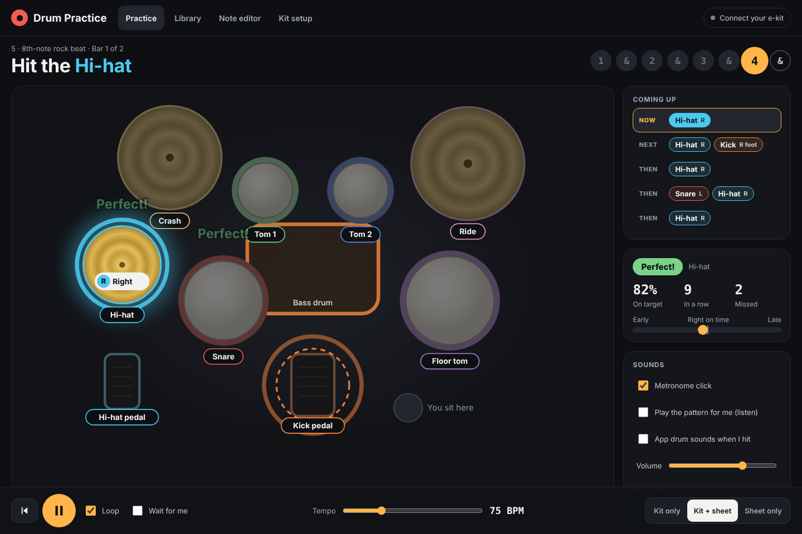
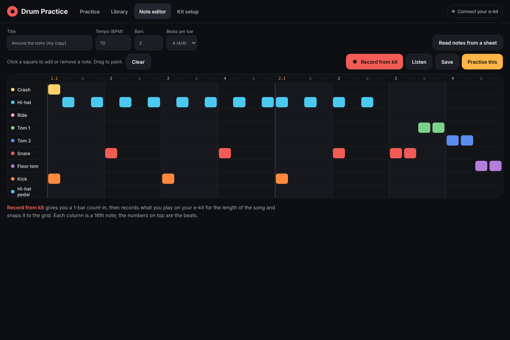
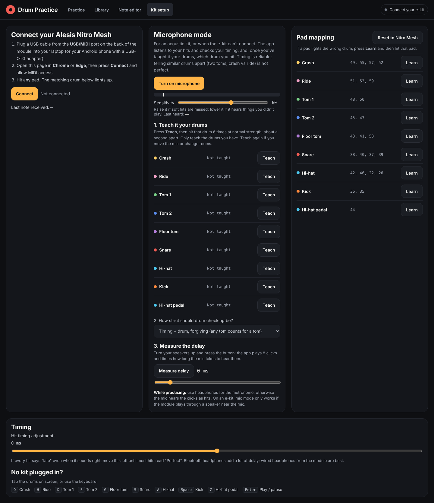

# User guide

This guide walks through every screen, assuming you've never played drums before.

- [The idea](#the-idea)
- [Practice screen](#practice-screen)
- [Library](#library)
- [Note editor](#note-editor)
- [Articulations](#articulations)
- [Reading sheet music](#reading-sheet-music)
- [Kit setup](#kit-setup)
- [Tips for beginners](#tips-for-beginners)
- [Frequently asked questions](#frequently-asked-questions)

## The idea

Drum music is a pattern of *which* drum to hit and *when*. The app shows both on a drawing of your kit:

- **Which:** the drum lights up and gets a "HIT" label.
- **When:** a coloured ring starts wide and shrinks onto the drum. Hit at the moment the ring touches the edge.
- **With what:** a white tag on the drum says *Right* or *Left* (hand), or *R foot* / *L foot*.
- **What's after that:** a dashed outline and "NEXT" mark the following drum, so you can get ready.

## Practice screen

### Top of the screen
- **Song and bar:** the lesson name, and where you are (count-in, or bar 2 of 4).
- **Instruction:** in plain words, e.g. *Hit Snare + Hi-hat together*. During the count-in it says *Get ready… 1, 2, 3, 4*.
- **Counter (1 & 2 & 3 & 4 &):** the current count is highlighted in orange. Counting out loud while you play helps a lot.

### The kit
The kit is drawn from above, as you see it sitting on the stool:

| Piece | Where | Usually played with |
|---|---|---|
| Hi-hat | left | right hand (crossed over the left) |
| Hi-hat pedal | bottom left | left foot (hold it down so the hi-hat stays closed) |
| Snare | front left | left hand |
| Kick pedal | bottom centre | right foot |
| Tom 1, Tom 2 | above the bass drum | either hand |
| Floor tom | right | either hand |
| Crash | top left | right hand |
| Ride | top right | right hand |

You can also **tap** a drum on screen (or use the keyboard) to play it.

### Side panel
- **Coming up:** the next five hits with hands, so you can read ahead.
- **Feedback:** what the last hit was (Perfect, Good · late, Too early, Miss, Wrong drum?).
- **On target:** percentage of hits that were Perfect or Good.
- **In a row:** your current streak.
- **Missed:** notes that went by without a hit.
- **Timing meter:** the dot shows whether you tend to be early (left) or late (right).

How the grades work:

| Grade | How close to the beat |
|---|---|
| Perfect | within 45 ms |
| Good | within 100 ms |
| Too early / too late | within 160 ms |
| Miss | no hit within 160 ms |

### Sounds
- **Metronome click:** a click on every beat, louder on beat 1. The 4-click count-in always plays.
- **Play the pattern for me:** the app plays the drums itself. Listen once, then turn it off and play.
- **App drum sounds when I hit:** for when your module is muted. Leave it off normally: the Nitro Mesh makes its own sound.
- **Listen with microphone:** turns on microphone mode (set it up in Kit setup first).

### Controls at the bottom
- **Back to start** and **Play / Pause** (or press Enter).
- **Loop:** repeat the song until you stop it.
- **Wait for me:** the song stops at each note until you hit it, so you can't fall behind and nothing counts as a miss. It's for learning the pattern; turn it off once you know it.
- **Tempo:** speed in beats per minute. Start slow; speed up only when you get 90% or more.
- **View:** Kit only, Kit + sheet, or Sheet only.

### Sheet music strip
A simplified version of real drum notation, scrolling with the music. Cymbals are drawn as **x**, drums as dots. From top to bottom: crash, hi-hat, ride, toms, snare (middle), floor tom, kick (bottom), hi-hat pedal (below). Glance at it while you play: over time you'll start reading it.

## Library

- **Beginner lessons:** go in order. Each adds one new thing. Your best score is shown next to each.
- **My songs:** things you imported or wrote. **Edit** opens the note editor; **Delete** needs a second press to confirm.
- **Adding music:** drop a file on the dashed box or use the buttons:
  - **MIDI file:** most drum MIDI files have the drums on channel 10, which the app reads.
  - **MusicXML:** export from MuseScore, Sibelius, Guitar Pro, etc. Choose *uncompressed MusicXML*.
  - **PDF or photo:** reads the notes automatically (see [Reading sheet music](#reading-sheet-music)).
  - **Write it yourself:** an empty note editor.

Imported songs always open in the editor first, so you can check them.

## Note editor

- Each **row** is a drum; each **column** is a 16th note. The numbers on top are beats (1, 2, 3, 4), with **&** halfway between.
- Choose **how** the note is played above the grid: Normal, Accent, Ghost note, Open hi-hat, Rimshot, Cross-stick, Ride bell, Flam or Choke. Then **click** a square to add it. Clicking a note again with the same choice removes it; with a different choice it changes it. **Drag** to paint several. Choices that don't fit a drum (an open snare) add a normal hit instead.
- **Title, Tempo, Bars, Beats per bar:** set these first. Reducing bars removes notes past the end.
- **Read notes from a sheet:** reads a PDF or photo and loads the notes (see below). The sheet stays visible above the grid; **Read again** retries with the other reader.
- **Record from kit:** a 1-bar count-in, then everything you play is snapped onto the grid for the length of the song, including open hi-hats and rimshots (from the pad) and accents and ghost notes (from how hard you hit). Recording adds to what's already there; use **Clear** to start over.
- **Listen:** plays the pattern with the app's drum sounds.
- **Save:** stores it in My songs. **Practise this** saves and opens it on the practice screen.
- Editing a built-in lesson saves a copy, so the lesson itself stays as it was.

## Articulations

An articulation is *how* a note is played. The app treats them as part of the music, never as an afterthought:

| What you'll see on the drum | Means | How to play it |
|---|---|---|
| **OPEN** (hi-hat) | Open hi-hat | Lift your left foot a little so the cymbals ring, then close it on the next note |
| **ACCENT** | Accent | Hit harder than the notes around it (raise the stick higher) |
| **GHOST** | Ghost note | Barely touch the drum: very soft, from a low stick height |
| **RIM** | Rimshot | Hit the head and the rim at the same time: a loud crack |
| **X-STICK** | Cross-stick | Lay the stick across the snare and click it against the rim |
| **BELL** (ride) | Ride bell | Hit the raised bell in the middle of the ride |
| **FLAM** | Flam | A soft grace note with the other hand just before the main hit |
| **CHOKE** | Choke | Grab the cymbal right after hitting it to stop the sound |

- The instruction line also says it, e.g. *Hit the Hi-hat (open)*, and **Coming up** shows it on each chip.
- The notation strip uses the usual symbols: `>` accent, `( )` ghost note, `o` open hi-hat, diamond = bell, slashed head = rimshot, circled x on the snare = cross-stick, small grace note = flam, `+` = choke.
- If you hit on time but the wrong way, you'll see **"Right time, wrong touch"** and a tip. With **Wait for me** on, the song waits until you get it right.
- Untick **Check how I play each note** (Sounds panel) to practise just the timing at first.
- **E-kit:** the Nitro Mesh sends different notes for open and closed hi-hat and for snare head and rim, so those are checked exactly. Accents and ghost notes are checked by how hard you hit; set the levels in **Kit setup → Accents and ghost notes** (*Last note received* shows each hit's velocity).
- **Keyboard:** hold **Shift** for the special stroke (Shift+A open hi-hat, Shift+S rimshot, Shift+H ride bell).
- Lessons 11 to 15 teach them one at a time.

## Reading sheet music

1. In **Library**, press **PDF or photo** (or drop the file on the dashed box). You can also use **Read notes from a sheet** in the note editor.
2. Check the page previews, then pick a reader:
   - **AI reader:** uses the AI provider you chose, with **your own** API key. Best for photos and anything complex. It works out the time signature and tempo itself.
   - **Offline reader:** free and private. Choose the time signature (4/4 or 3/4) first.
3. Press **Read notes**. The song opens in the note editor with the sheet above the grid. After the offline reader, the sheet is marked with what was found: coloured circles around notes, blue lines on barlines and bar numbers.
4. Compare the grid with the sheet, fix anything wrong, set the tempo, then press **Practise this**.

**Setting up the AI reader (Library → Sheet reading):**
1. Pick an **AI provider**:
   - **Google Gemini** (the default): free tier, no payment needed. Sign in at [aistudio.google.com/apikey](https://aistudio.google.com/apikey) with a Google account and press *Create API key*. The free tier has daily limits, and Google may use free-tier requests to improve its products.
   - **Groq**: free plan, very fast. Create a key at [console.groq.com/keys](https://console.groq.com/keys). Use the suggested vision model (Llama 4 Scout).
   - **OpenRouter**: one key for many models, including free ones. Create a key at [openrouter.ai/settings/keys](https://openrouter.ai/settings/keys). The default model `openrouter/free` picks a free model for you; for steadier results press **Load models** and choose a specific vision model (free ones end in `:free`).
   - **Alibaba Cloud Model Studio** (Qwen): create a Model Studio API key. The base URL depends on your region: Singapore `https://dashscope-intl.aliyuncs.com/compatible-mode/v1` (default), Virginia `https://dashscope-us.aliyuncs.com/compatible-mode/v1`, Beijing `https://dashscope.aliyuncs.com/compatible-mode/v1`. Keys only work in their own region.
   - **Mistral**: key from [console.mistral.ai](https://console.mistral.ai/api-keys); use Load models and pick a vision model.
   - **Hugging Face**: a token from [huggingface.co/settings/tokens](https://huggingface.co/settings/tokens). Model names look like `owner/model:provider`.
   - **Anthropic Claude**: needs prepaid credit. Key from [console.anthropic.com](https://console.anthropic.com/settings/keys).
   - **Any other service**: choose **+ Add another service…**, type its name, its base URL (from the service's API docs; usually ends in `/v1`) and your key, then **Load models**. You can add several and switch between them; **Remove** deletes one.
   - **Other OpenAI-compatible service**: enter its **Base URL** (for example `https://api.openai.com/v1`, `http://localhost:1234/v1` for LM Studio, or `http://localhost:11434/v1` for Ollama), a key if it needs one, and a model that can read images. Ollama and LM Studio run on your own computer: free, private and no limits, but you need a vision model downloaded and a reasonably fast computer. For Ollama, start it with `OLLAMA_ORIGINS=*` so web pages may talk to it.
2. Paste your key and press **Save key**, then **Test key**. This only lists your models, so it costs nothing.
3. **Model:** keep the suggested one, or press **Load models** and pick from the list. Bigger models read better; free and small ones make more mistakes.
4. Untick **Remember keys on this device** if you'd rather paste the key each session (useful on a shared computer).
5. **Which reader:** "AI if a key is set, otherwise offline" is the default.

Keys are stored only in this browser and sent only to the provider you chose. They're not in the app's code or on GitHub, so anyone else using the app needs their own.

**Getting good results from the offline reader:**
- Use a PDF, or a photo taken straight on from above, in good even light, with the whole page in frame.
- Printed music works; handwriting doesn't.
- Simple grooves and fills read well. Triplets, repeat signs, "repeat bar" marks, multi-bar rests and very dense 32nd-note passages don't. Use the AI reader for those.
- The offline reader finds which drum and when, but **not** accents, ghost notes or open hi-hats. Add those in the editor with the articulation buttons, or use the AI reader, which transcribes them.

## Kit setup

### Your kits

The drawing on the practice screen is your kit, and you can change it to match the real one:
- **Add a piece:** choose a type and press **Add**. It goes into a free spot; **drag** it to the right place.
- **Rename** a piece by editing its name, **resize** it with its slider, or **Remove** it.
- **Create kit** from a preset (standard, small, big) or as a copy of the current kit. Choose which kit you're using with **Kit in use**, and **Delete kit** (press twice) to remove one.
- Each kit keeps its own **pad mapping** and **microphone training**, so set those up for each kit.
- If a song uses a piece your kit doesn't have, it's played on the closest piece you do have (Tom 3 → Tom 2, Crash 2 → Crash, and so on). A second kick pedal counts as the **left foot** of a double pedal.
- Extra pieces get their own keyboard keys; the list is under *No kit plugged in?*

### E-kit over USB
Connect the module by USB, press **Connect**, and allow MIDI. **Last note received** shows the note number of each pad you hit, which is useful for troubleshooting.

### Pad mapping
Each drum lists the MIDI note numbers that trigger it. If a pad lights the wrong drum, press **Learn** on the correct drum and hit the pad. **Reset to Nitro Mesh** restores the defaults.

### Microphone mode
1. **Turn on microphone** and allow access. The level bar shows what the mic hears; the white line is the trigger level.
2. **Sensitivity:** raise it if soft hits are missed; lower it if it reacts to talking or other noise.
3. **Teach it your drums:** for each drum you have, press **Teach** and hit it 6 times at normal strength, about a second apart. Re-teach if you move the mic or the kit.
4. **Drum checking:**
   - *Forgiving* (recommended): any tom counts for a tom, and crash and ride are interchangeable.
   - *Strict:* every drum must sound like the one expected.
   - *Timing only:* any hit counts; only the timing is graded.
5. **Measure delay:** with your speakers up, the app plays 8 clicks and measures how late the mic hears them. You can also drag the slider by hand.

Good microphone placement: about 1 m in front of the kit, at roughly head height, pointing at the snare. A phone propped on a music stand works.

Use **headphones** for the metronome while the mic is on.

### Timing
If hits are always reported late (or early) even when they sound right, move **Hit timing adjustment** until most hits read "Perfect". This adjusts USB, tap and keyboard input; the microphone has its own delay setting.

### Keyboard
`A` hi-hat · `S` snare · `Space` kick · `D` tom 1 · `F` tom 2 · `G` floor tom · `Q` crash · `H` ride · `Z` hi-hat pedal · `Enter` play/pause.

## Tips for beginners

1. **Go slow.** If you're under 80% on target, lower the tempo by 10 BPM.
2. **Use Wait for me** the first few times through a new lesson.
3. **Count out loud:** "one and two and three and four and".
4. **Relax your grip.** Let the stick bounce off the pad.
5. **Little and often:** 15 minutes a day beats an hour once a week.
6. **Move on** to the next lesson when you can do the current one twice in a row at 90% or more.

## Frequently asked questions

**Why don't my songs show up on my phone?**
Each browser keeps its own storage. Import the file again on the phone.

**Does anything get uploaded?**
No. The app runs entirely in your browser. Files you open are read on your device only.

**The kit isn't detected.**
Use Chrome or Edge (Safari can't read MIDI), check that the module is on, try another USB cable (some only carry power), then press **Connect** again.

**The microphone hears the metronome.**
Use headphones for the app's sound, or turn the metronome off and rely on the count-in.

**Can it read my PDF automatically?**
Yes: use the AI reader (with your own API key) for the best results, or the free offline reader for clean printed sheets. Always check the result in the note editor.

**Will other people using my app spend my API credit?**
No. There's no key in the app. Each person adds their own key in their own browser.

**Do I have to pay for the AI reader?**
No. Google Gemini's free tier, Groq's free plan and OpenRouter's free models all work without payment, within their limits; a local Ollama or LM Studio model is free with no limits. If you hit a limit, wait (or try the next day), switch provider, or use the offline reader.

**It says the model used up its answer limit.**
Some free models (often picked by OpenRouter's random free router) spend their whole output allowance "thinking" before writing anything. Press **Load models** and pick a specific free vision model, or switch to Gemini or Groq.
