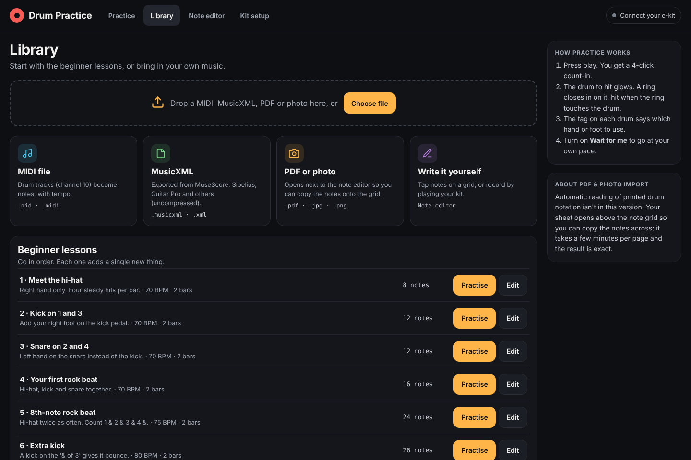

# User guide

This guide walks through every screen, assuming you've never played drums before.

- [The idea](#the-idea)
- [Practice screen](#practice-screen)
- [Library](#library)
- [Note editor](#note-editor)
- [Kit setup](#kit-setup)
- [Tips for beginners](#tips-for-beginners)
- [Frequently asked questions](#frequently-asked-questions)

## The idea

Drum music is a pattern of *which* drum to hit and *when*. The app shows both on a drawing of your kit:

- **Which:** the drum lights up and gets a "HIT" label.
- **When:** a coloured ring starts wide and shrinks onto the drum. Hit at the moment the ring touches the edge.
- **With what:** a white tag on the drum says *Right* or *Left* (hand), or *R foot* / *L foot*.
- **What's after that:** a dashed outline and "NEXT" mark the following drum, so you can get ready.

## Practice screen

### Top of the screen
- **Song and bar:** the lesson name, and where you are (count-in, or bar 2 of 4).
- **Instruction:** in plain words, e.g. *Hit Snare + Hi-hat together*. During the count-in it says *Get ready… 1, 2, 3, 4*.
- **Counter (1 & 2 & 3 & 4 &):** the current count is highlighted in orange. Counting out loud while you play helps a lot.

### The kit
The kit is drawn from above, as you see it sitting on the stool:

| Piece | Where | Usually played with |
|---|---|---|
| Hi-hat | left | right hand (crossed over the left) |
| Hi-hat pedal | bottom left | left foot (hold it down so the hi-hat stays closed) |
| Snare | front left | left hand |
| Kick pedal | bottom centre | right foot |
| Tom 1, Tom 2 | above the bass drum | either hand |
| Floor tom | right | either hand |
| Crash | top left | right hand |
| Ride | top right | right hand |

You can also **tap** a drum on screen (or use the keyboard) to play it.

### Side panel
- **Coming up:** the next five hits with hands, so you can read ahead.
- **Feedback:** what the last hit was (Perfect, Good · late, Too early, Miss, Wrong drum?).
- **On target:** percentage of hits that were Perfect or Good.
- **In a row:** your current streak.
- **Missed:** notes that went by without a hit.
- **Timing meter:** the dot shows whether you tend to be early (left) or late (right).

How the grades work:

| Grade | How close to the beat |
|---|---|
| Perfect | within 45 ms |
| Good | within 100 ms |
| Too early / too late | within 160 ms |
| Miss | no hit within 160 ms |

### Sounds
- **Metronome click:** a click on every beat, louder on beat 1. The 4-click count-in always plays.
- **Play the pattern for me:** the app plays the drums itself. Listen once, then turn it off and play.
- **App drum sounds when I hit:** for when your module is muted. Leave it off normally: the Nitro Mesh makes its own sound.
- **Listen with microphone:** turns on microphone mode (set it up in Kit setup first).

### Controls at the bottom
- **Back to start** and **Play / Pause** (or press Enter).
- **Loop:** repeat the song until you stop it.
- **Wait for me:** the song stops at each note until you hit it, so you can't fall behind and nothing counts as a miss. It's for learning the pattern; turn it off once you know it.
- **Tempo:** speed in beats per minute. Start slow; speed up only when you get 90% or more.
- **View:** Kit only, Kit + sheet, or Sheet only.

### Sheet music strip
A simplified version of real drum notation, scrolling with the music. Cymbals are drawn as **x**, drums as dots. From top to bottom: crash, hi-hat, ride, toms, snare (middle), floor tom, kick (bottom), hi-hat pedal (below). Glance at it while you play: over time you'll start reading it.

## Library

- **Beginner lessons:** go in order. Each adds one new thing. Your best score is shown next to each.
- **My songs:** things you imported or wrote. **Edit** opens the note editor; **Delete** needs a second press to confirm.
- **Adding music:** drop a file on the dashed box or use the buttons:
  - **MIDI file:** most drum MIDI files have the drums on channel 10, which the app reads.
  - **MusicXML:** export from MuseScore, Sibelius, Guitar Pro, etc. Choose *uncompressed MusicXML*.
  - **PDF or photo:** opens the note editor with your sheet shown above the grid. Copy the notes across.
  - **Write it yourself:** an empty note editor.

Imported songs always open in the editor first, so you can check them.

## Note editor

- Each **row** is a drum; each **column** is a 16th note. The numbers on top are beats (1, 2, 3, 4), with **&** halfway between.
- **Click** a square to add or remove a note; **drag** to paint several.
- **Title, Tempo, Bars, Beats per bar:** set these first. Reducing bars removes notes past the end.
- **Show sheet to copy from:** opens a PDF or photo above the grid.
- **Record from kit:** a 1-bar count-in, then everything you play is snapped onto the grid for the length of the song. Recording adds to what's already there; use **Clear** to start over.
- **Listen:** plays the pattern with the app's drum sounds.
- **Save:** stores it in My songs. **Practise this** saves and opens it on the practice screen.
- Editing a built-in lesson saves a copy, so the lesson itself stays as it was.

## Kit setup

### E-kit over USB
Connect the module by USB, press **Connect**, and allow MIDI. **Last note received** shows the note number of each pad you hit, which is useful for troubleshooting.

### Pad mapping
Each drum lists the MIDI note numbers that trigger it. If a pad lights the wrong drum, press **Learn** on the correct drum and hit the pad. **Reset to Nitro Mesh** restores the defaults.

### Microphone mode
1. **Turn on microphone** and allow access. The level bar shows what the mic hears; the white line is the trigger level.
2. **Sensitivity:** raise it if soft hits are missed; lower it if it reacts to talking or other noise.
3. **Teach it your drums:** for each drum you have, press **Teach** and hit it 6 times at normal strength, about a second apart. Re-teach if you move the mic or the kit.
4. **Drum checking:**
   - *Forgiving* (recommended): any tom counts for a tom, and crash and ride are interchangeable.
   - *Strict:* every drum must sound like the one expected.
   - *Timing only:* any hit counts; only the timing is graded.
5. **Measure delay:** with your speakers up, the app plays 8 clicks and measures how late the mic hears them. You can also drag the slider by hand.

Good microphone placement: about 1 m in front of the kit, at roughly head height, pointing at the snare. A phone propped on a music stand works.

Use **headphones** for the metronome while the mic is on.

### Timing
If hits are always reported late (or early) even when they sound right, move **Hit timing adjustment** until most hits read "Perfect". This adjusts USB, tap and keyboard input; the microphone has its own delay setting.

### Keyboard
`A` hi-hat · `S` snare · `Space` kick · `D` tom 1 · `F` tom 2 · `G` floor tom · `Q` crash · `H` ride · `Z` hi-hat pedal · `Enter` play/pause.

## Tips for beginners

1. **Go slow.** If you're under 80% on target, lower the tempo by 10 BPM.
2. **Use Wait for me** the first few times through a new lesson.
3. **Count out loud:** "one and two and three and four and".
4. **Relax your grip.** Let the stick bounce off the pad.
5. **Little and often:** 15 minutes a day beats an hour once a week.
6. **Move on** to the next lesson when you can do the current one twice in a row at 90% or more.

## Frequently asked questions

**Why don't my songs show up on my phone?**
Each browser keeps its own storage. Import the file again on the phone.

**Does anything get uploaded?**
No. The app runs entirely in your browser. Files you open are read on your device only.

**The kit isn't detected.**
Use Chrome or Edge (Safari can't read MIDI), check that the module is on, try another USB cable (some only carry power), then press **Connect** again.

**The microphone hears the metronome.**
Use headphones for the app's sound, or turn the metronome off and rely on the count-in.

**Can it read my PDF automatically?**
Not in this version. It shows the PDF next to the editor so you can copy it across.
